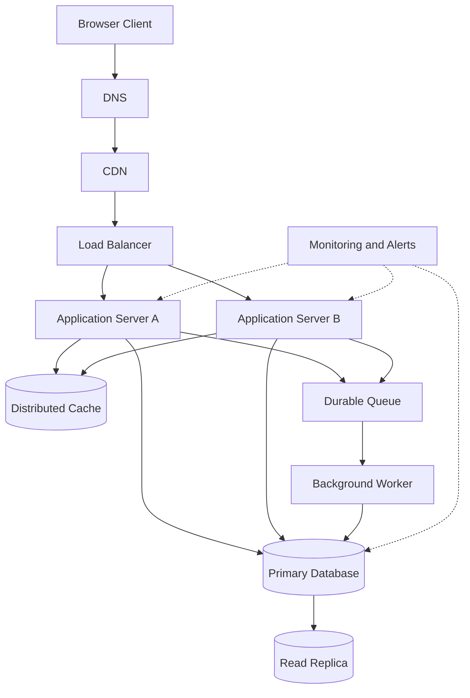

# QuickNotes System Architecture

## 1. Functional Requirements

- Users can register and authenticate.
- Users can create, read, update, and delete notes.
- Users can organise notes with tags.
- Users can search and filter their notes.
- Each user can access only their own private notes.
- The API validates requests and returns consistent errors.

## 2. Non-Functional Requirements

- Availability target: 99.9% per month.
- Performance target: 95% of note reads complete within 300 ms under normal load.
- Security: HTTPS, secure password hashing, authentication, and access control.
- Reliability: backups, health checks, monitoring, and tested recovery procedures.
- Scalability: application instances and read capacity can scale horizontally.
- Maintainability: automated tests, versioned APIs, database migrations, and centralised logs.

## 3. Load Estimate for One Million Users

These estimates are planning assumptions, not measured production traffic.

Assumptions:
- 1,000,000 registered users.
- 10% are active each day, giving 100,000 daily active users.
- Each daily active user makes 20 reads and 2 writes per day.

### Reads per second

Daily reads:

100,000 × 20 = 2,000,000 reads/day

Average reads per second:

2,000,000 ÷ 86,400 ≈ 23 reads/second.

With a 10× peak allowance, plan for approximately 230 reads/second.

### Writes per second

Daily writes:

100,000 × 2 = 200,000 writes/day

Average writes per second:

200,000 ÷ 86,400 ≈ 2.3 writes/second.

With a 10× peak allowance, plan for approximately 23 writes/second.

### Storage per year

Assume:
- 200,000 new notes each day.
- Each note averages 2 KB, including its content and basic metadata.

Daily raw storage:

200,000 × 2 KB = 400 MB/day.

Annual raw storage:

400 MB × 365 = approximately 146 GB/year.

This estimate excludes indexes, backups, replicas, logs, and attachments. Actual capacity should be determined through measurement and load testing.

## 4. Architecture Diagram

## 5. Component Responsibilities

- **Browser client:** provides the user interface and sends API requests.
- **DNS:** resolves the service hostname to the correct network destination.
- **CDN:** serves static assets near users and reduces origin traffic.
- **Load balancer:** distributes requests between healthy application servers.
- **Application servers:** execute API logic, authenticate requests, validate data, and communicate with storage services.
- **Distributed cache:** stores frequently requested data to reduce repeated database reads.
- **Primary database:** stores authoritative application data and handles writes.
- **Read replica:** provides additional capacity for eligible read queries.
- **Durable queue:** buffers background work and separates it from user-facing requests.
- **Background worker:** processes asynchronous tasks such as notifications and exports.
- **Monitoring and alerts:** tracks errors, latency, resource usage, and failed background jobs.

## 6. GET /api/v1/notes Request Flow

1. The browser resolves the API hostname through DNS and sends an HTTPS request.
2. The CDN serves cacheable static assets; authenticated API responses generally bypass shared CDN caching.
3. The load balancer routes the request to a healthy application server.
4. The application authenticates the user and obtains the user ID from the verified identity.
5. The application checks the distributed cache using a key scoped to the user and query parameters.
6. If the cache misses, the application queries the read replica when appropriate, or the primary when read-after-write consistency is required.
7. The application returns `200 OK` with the notes and pagination metadata.

An empty result is returned as `200 OK` with an empty data array.

## 7. POST /api/v1/notes Request Flow

1. The browser sends an HTTPS POST request with a JSON body and authentication token.
2. The load balancer forwards the request to a healthy application server.
3. The application authenticates the user and validates the title and body.
4. The application inserts the note into the primary database using a transaction.
5. The server assigns the note ID, owner ID, and timestamps.
6. The application invalidates affected cache entries.
7. Optional background work is published to the durable queue.
8. The API returns `201 Created` with the saved note.

## 8. Trade-Offs

### Cache vs Consistency

Caching reduces latency and database load but can return stale information. Use short time-to-live settings, user-specific cache keys, and invalidation after writes. Use the primary database when immediate read-after-write consistency is required.

### Read Replica vs Consistency

A read replica increases read capacity but replication can lag behind the primary. Use the primary for writes and consistency-sensitive reads, and monitor replication lag.

### Queue vs Immediate Processing

A queue keeps slow background work out of the request path, but tasks may complete later or be delivered more than once. Use idempotent jobs, retry limits, exponential backoff, and a dead-letter queue.

### Multiple Servers vs Cost

Multiple application servers cost more than a single instance, but they allow horizontal scaling and maintenance without taking the entire application offline.

## 9. Avoiding Single Points of Failure

Run at least two application servers across separate availability zones behind a health-checking load balancer. Use redundant DNS, a highly available database configuration, tested replica promotion, replicated or managed cache and queue services, and workers in multiple zones.

Maintain automated database backups and regularly test restoration and failover. A read replica alone does not guarantee automatic database failover, so recovery procedures and recovery objectives must be explicitly configured and tested.
